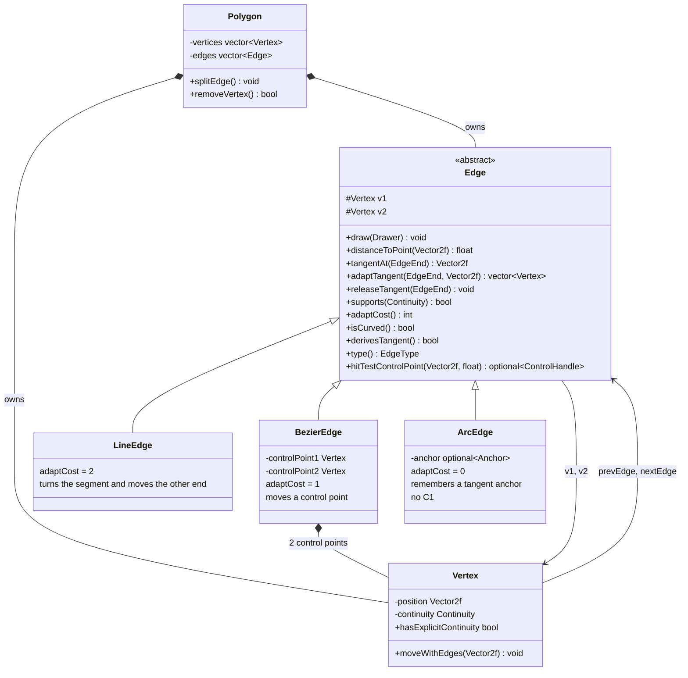
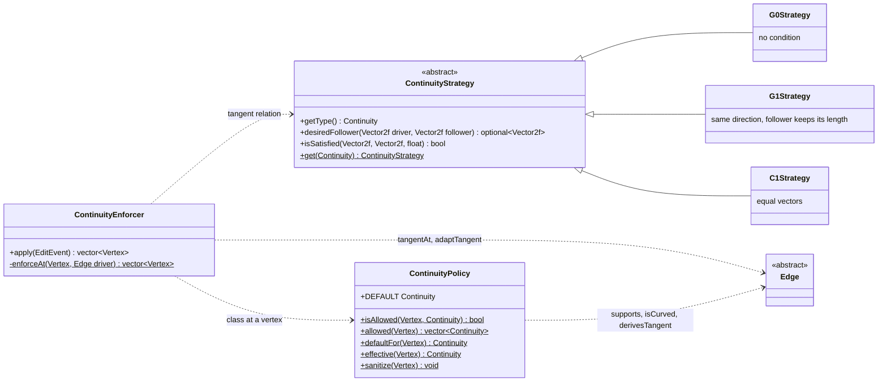
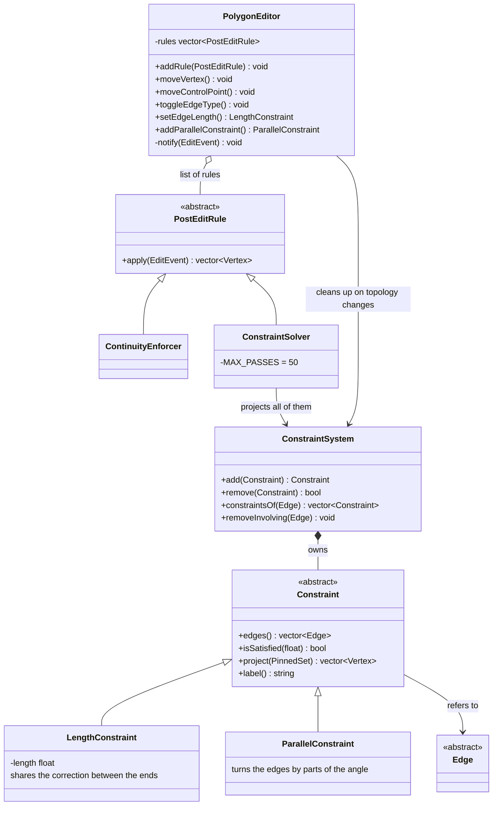
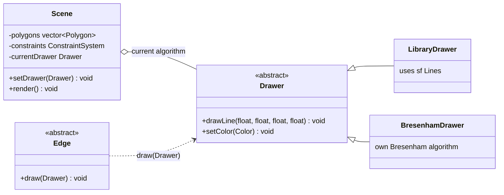

# Polygon and Curvilinear Polygon Editor

An interactive 2D editor written in C++20 with **SFML 2.6** and **Dear ImGui**. It lets you edit polygons (self-intersections included), turn edges into cubic Bézier segments or circular arcs, keep vertex continuity (G0, G1, C1) and impose geometric constraints (length, parallelism) in real time. The full documentation is available in the program itself (**F1**, in Polish). The mathematics behind the algorithms (Bézier curves, arcs, continuity, constraints, Bresenham) is derived in [mathdocs](mathdocs/README.md).

---

## Features

* **Polygons:** any number of polygons from the predefined scene, self-intersections allowed, moving a vertex, a control point or a whole polygon, removing a vertex, adding a vertex in the middle of an edge.
* **Edges:** every edge can be switched between a segment, a cubic Bézier segment (with a dashed control polygon and two draggable control points) and a circular arc.
* **Vertex continuity:** G0, G1 and C1 for Bézier, G0 and G1 for arcs (only one end of an arc can be G1; with G0 at both ends the arc is a semicircle). G1 is the default. Changing one element forces matching changes in others.
* **Geometric constraints:** a fixed segment length and parallelism of two segments (also from different polygons). One edge can carry several constraints; active ones are marked with labels on the scene and can be removed.
* **Drawing algorithms:** library line drawing or a custom Bresenham implementation (radio buttons); Bézier segments are drawn with an incremental algorithm in the power basis.
* **Predefined scene:** two polygons (with a Bézier curve and an arc) and four constraints.

---

## Controls

| Action | Effect |
|---|---|
| LMB on a vertex + drag | moves the vertex (it follows the cursor) |
| Shift + LMB on a vertex + drag | moves the whole polygon |
| LMB on a Bézier control point + drag | moves the control point |
| LMB on an edge | selects the edge; dragging moves the polygon |
| LMB inside a polygon + drag | moves the polygon |
| Ctrl + LMB on an edge | picks the second edge (e.g. for parallelism) |
| RMB on a vertex | removes the vertex (a polygon keeps at least 3) |
| RMB on an edge | adds a vertex in its middle |
| Delete / Backspace | removes the selected vertex |
| F1 | documentation window |

The control panel offers: the drawing algorithm, scene reset, the type of the selected edge, constraints (length, parallelism, a list with removal) and the continuity of the selected vertex (only the classes allowed at that place).

---

## Architecture

```text
.
├── makefile
├── README.md
├── imgui/                    # Dear ImGui + ImGui-SFML
├── tests/                    # unit tests (no window), make test
└── src/
    ├── main.cpp              # wiring: scene, editor with rules, UI
    ├── enum/                 # Continuity, EdgeEnd, EdgeType
    ├── model/
    │   ├── vertex.*, polygon.*
    │   ├── edge/             # Edge (tangent interface), LineEdge, BezierEdge, ArcEdge, factory
    │   ├── continuity_strategy.hpp   # G0/G1/C1: math on tangent vectors
    │   ├── continuity_policy.*       # what is allowed at a vertex, default values
    │   └── constraint/       # Constraint, LengthConstraint, ParallelConstraint, ConstraintSystem
    ├── editing/              # PolygonEditor, PostEditRule, ContinuityEnforcer, ConstraintSolver
    ├── scene/                # Scene: polygons, constraints, the predefined scene
    ├── builder/              # PolygonBuilder, PolygonDirector
    ├── ui/                   # InputHandler, UIManager, documentation window
    └── utils/                # Drawer (library, Bresenham), vector helpers
```

Main design decisions:

* **The tangent as a common abstraction.** Every edge can report (`tangentAt`) and change (`adaptTangent`) its tangent at a given end. Continuity strategies therefore know nothing about edge types, and a new edge type needs no change in the continuity algorithm.
* **Continuity strategies** (`ContinuityStrategy`) describe the relation of two tangents: G0 - no condition, G1 - the same direction, C1 - equal vectors.
* **`ContinuityEnforcer`** checks the vertices touched by an edit in a work queue. A broken relation is repaired by one of the edges (the follower): the edge dragged by the user is always the driver, otherwise the edge with the lower `adaptCost` gives way (arc, Bézier, segment). A Bézier moves its control point, an arc remembers a tangent anchor, a segment turns around the vertex.
* **Constraints** are separate objects (`Constraint`) kept in a `ConstraintSystem` owned by the scene. `ConstraintSolver` projects them one by one (Gauss-Seidel) and never moves the vertices pinned by the user.
* **`PolygonEditor`** is the only entry point for edits and applies the rules (`PostEditRule`) in a fixed-point loop, because continuity and constraints can break each other. It also cleans up: changing the type of an edge, splitting it or removing a vertex deletes the constraints of the affected edges and fixes the continuity.
* **Extensibility:** a new kind of constraint, edge, continuity class or post-edit rule is a new class with no change in existing code (see the "Rozszerzanie" tab of the F1 window).

## Polymorphism in the project (UML diagrams)

There are four polymorphic hierarchies. A client (e.g. `ContinuityEnforcer`, `Scene`) only knows the interface, so a new type is a new class and existing code stays untouched (the open-closed principle). The diagrams use Mermaid, which GitHub renders.

### 1. Edges: one tangent interface, three geometries

`ContinuityEnforcer` only asks an edge for `tangentAt` and tells it to adapt through `adaptTangent`. It does not know whether it faces a segment, a curve or an arc: a segment turns around its vertex, a Bézier moves a control point and an arc remembers an anchor.



### 2. Continuity: a strategy independent of the edge type

A strategy gets just two tangent vectors, so the same `G1Strategy` handles Bézier-segment, Bézier-arc and every other pair.



### 3. Editing: post-edit rules and constraints

`PolygonEditor` does not know which rules it runs: it holds a list of `PostEditRule` and repeats it until a fixed point. `ConstraintSolver` in turn does not know which constraints it projects: it calls `project` on the `Constraint` interface.



### 4. Drawing: an interchangeable algorithm

Switching the algorithm (radio button) replaces the `Drawer` object in the scene. Segments, curves and arcs are all drawn through the same interface.



### Where polymorphism actually works

| Call through an interface | Caller | What happens depending on the type |
|---|---|---|
| `edge->tangentAt(end)` | `ContinuityEnforcer`, `ContinuityPolicy` | segment: `v2 - v1`; Bézier: `3 (P1 - P0)`; arc: derivative along the circle |
| `edge->adaptTangent(end, d)` | `ContinuityEnforcer` | a segment turns, a Bézier moves a point, an arc remembers an anchor |
| `edge->adaptCost()` | `ContinuityEnforcer` | chooses which edge gives way (arc, Bézier, segment) |
| `strategy.desiredFollower(a, b)` | `ContinuityEnforcer` | G0 nothing, G1 direction, C1 the whole vector |
| `constraint->project(pinned)` | `ConstraintSolver` | length rescales a segment, parallelism turns the edges |
| `rule->apply(event)` | `PolygonEditor` | continuity first, then constraints, in a fixed-point loop |
| `edge->draw(drawer)`, `drawer.drawLine(...)` | `Scene` | two independent axes of variation: the shape of an edge and the drawing algorithm |

### Predefined scene

The scene is built by `Scene::initPredefinedScene()` ([src/scene/scene.cpp](src/scene/scene.cpp)). Adding a polygon or a constraint takes one line:

```cpp
Polygon& triangle = addPolygon(PolygonDirector::createDemoPolygon1());
constraints.add(std::make_unique<LengthConstraint>(triangle.getEdge(1), 150.0f));
constraints.add(std::make_unique<ParallelConstraint>(triangle.getEdge(1), diamond.getEdge(3)));
```

---

## Mathematical documentation

The [mathdocs](mathdocs/README.md) folder describes the mathematics behind the project, with the formulas matching the code:

* [conventions](mathdocs/01-conventions.md) - vectors, cross product, rotations, tangents of the edges,
* [cubic Bézier segments](mathdocs/02-bezier.md) - power basis and the incremental algorithm (forward differences),
* [circular arcs](mathdocs/03-arc.md) - the arc through two points with a given tangent,
* [continuity](mathdocs/04-continuity.md) - G0 / G1 / C1, repairing a vertex, propagation, the continuity policy,
* [constraints](mathdocs/05-constraints.md) - length and parallelism as projections, Gauss-Seidel, cooperation with continuity,
* [drawing and hit testing](mathdocs/06-drawing-and-hit-testing.md) - Bresenham, distances, point in polygon,
* [numerical parameters](mathdocs/07-numerical-parameters.md).

---

## Assumptions

* Constraints apply to segments only; turning an edge into a curve, splitting it or removing one of its vertices deletes its constraints.
* Implemented: a fixed length and parallelism (surnames A-K). Perpendicularity (L-Z) is not implemented.
* The default continuity is G1 (`ContinuityPolicy::DEFAULT`); a choice made by the user is never overwritten by the default.
* Continuity only matters at a vertex next to a curve.
* A dragged vertex always follows the cursor; with contradicting constraints a residual error remains (iteration limit).
* Splitting an edge yields two segments.

---

## Building and running (Linux)

Requirements: `g++` (C++20), SFML 2.6 (graphics, window and system modules) and OpenGL. On Ubuntu:

```bash
sudo apt install build-essential libsfml-dev libgl-dev
```

Build and run (the makefile uses AddressSanitizer and tracks header dependencies):

```bash
make
./app
```

Unit tests (no window):

```bash
make test
```

Cleaning: `make clean`.
