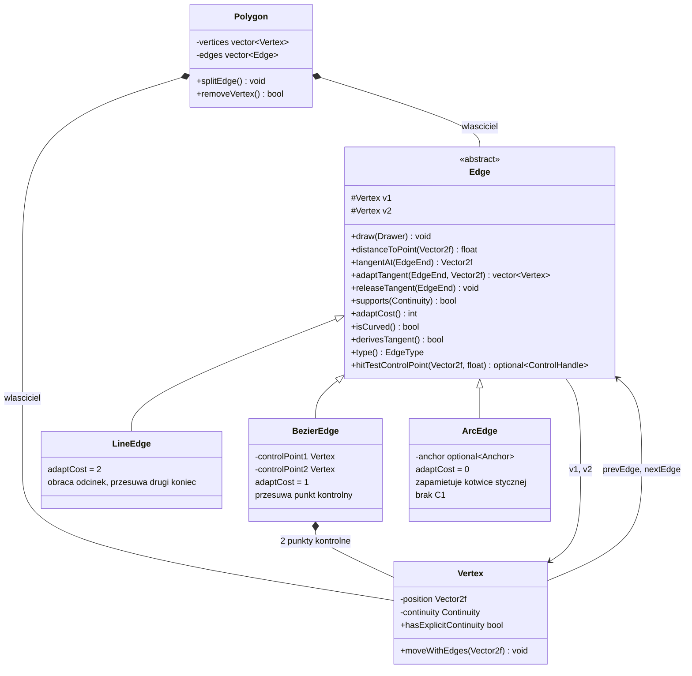
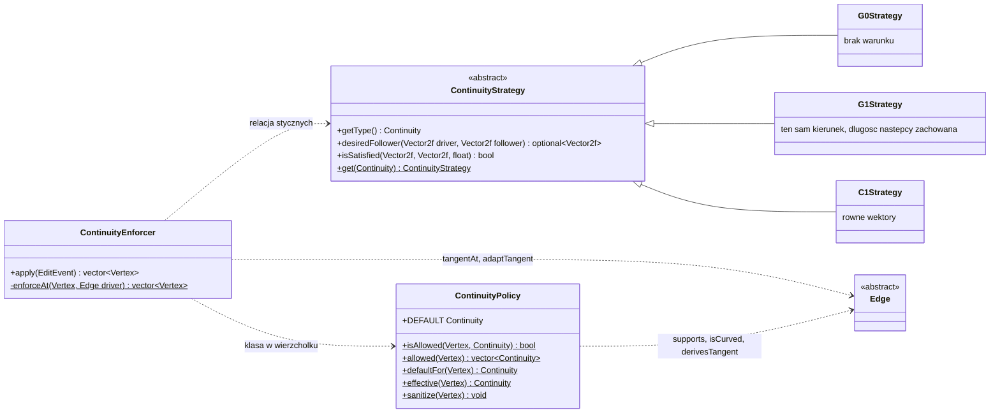
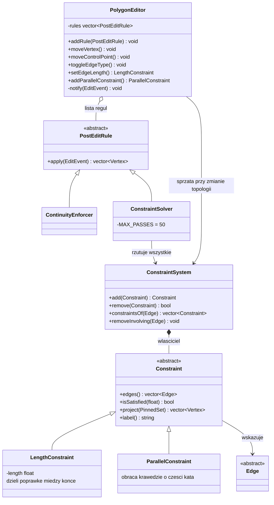
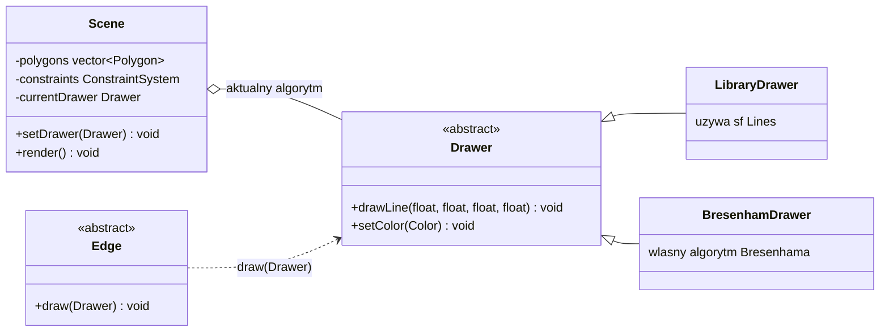

# Edytor wielokątów i wielokątów krzywoliniowych

Interaktywny edytor 2D napisany w C++20 z użyciem **SFML 2.6** i **Dear ImGui**. Pozwala edytować wielokąty (także z samoprzecięciami), zamieniać krawędzie na segmenty Béziera 3. stopnia i łuki okręgów, wymuszać ciągłość w wierzchołkach (G0, G1, C1) oraz zadawać ograniczenia geometryczne (długość, równoległość) w czasie rzeczywistym. Pełna dokumentacja jest dostępna w programie (**F1**).

---

## Funkcje

* **Wielokąty:** dowolna liczba wielokątów ze sceny początkowej, samoprzecięcia, przesuwanie wierzchołka, punktu kontrolnego i całego wielokąta, usuwanie wierzchołka, dodawanie wierzchołka w środku krawędzi.
* **Krawędzie:** każdą krawędź można przełączyć między odcinkiem, segmentem Béziera 3. stopnia (z przerywanym wielobokiem kontrolnym i dwoma przesuwalnymi punktami kontrolnymi) a łukiem okręgu.
* **Ciągłość w wierzchołkach:** G0, G1 i C1 dla Béziera, G0 i G1 dla łuku (tylko jeden koniec łuku może być G1; przy G0 na obu końcach łuk jest półokręgiem). Domyślnie G1. Zmiana jednego elementu wymusza odpowiednie zmiany innych.
* **Ograniczenia geometryczne:** zadana długość odcinka i równoległość dwóch odcinków (także z różnych wielokątów). Na jednej krawędzi może być kilka ograniczeń; aktywne są oznaczone etykietami na scenie, można je usuwać.
* **Algorytmy rysowania:** odcinki biblioteczne albo własny algorytm Bresenhama (radio buttony); segmenty Béziera rysowane algorytmem przyrostowym w bazie potęgowej.
* **Scena początkowa:** dwa wielokąty (z krzywą Béziera i łukiem) oraz cztery ograniczenia.

---

## Sterowanie

| Akcja | Efekt |
|---|---|
| LPM na wierzchołku + przeciąganie | przesuwa wierzchołek (podąża za kursorem) |
| Shift + LPM na wierzchołku + przeciąganie | przesuwa cały wielokąt |
| LPM na punkcie kontrolnym Béziera + przeciąganie | przesuwa punkt kontrolny |
| LPM na krawędzi | zaznacza krawędź; przeciąganie przesuwa wielokąt |
| LPM wewnątrz wielokąta + przeciąganie | przesuwa wielokąt |
| Ctrl + LPM na krawędzi | wybiera drugą krawędź (np. do równoległości) |
| PPM na wierzchołku | usuwa wierzchołek (min. 3 w wielokącie) |
| PPM na krawędzi | dodaje wierzchołek w jej środku |
| Delete / Backspace | usuwa zaznaczony wierzchołek |
| F1 | okno dokumentacji |

Panel sterowania: wybór algorytmu rysowania, reset sceny, typ zaznaczonej krawędzi, ograniczenia (długość, równoległość, lista z usuwaniem) i wybór ciągłości zaznaczonego wierzchołka (tylko klasy dozwolone w tym miejscu).

---

## Architektura

```text
.
├── makefile
├── README.md
├── imgui/                    # Dear ImGui + ImGui-SFML
├── tests/                    # testy jednostkowe (bez okna), make test
└── src/
    ├── main.cpp              # składanie: scena, edytor z regułami, UI
    ├── enum/                 # Continuity, EdgeEnd, EdgeType
    ├── model/
    │   ├── vertex.*, polygon.*
    │   ├── edge/             # Edge (interfejs stycznych), LineEdge, BezierEdge, ArcEdge, fabryka
    │   ├── continuity_strategy.hpp   # G0/G1/C1: matematyka na wektorach stycznych
    │   ├── continuity_policy.*       # co jest dozwolone w wierzchołku, wartości domyślne
    │   └── constraint/       # Constraint, LengthConstraint, ParallelConstraint, ConstraintSystem
    ├── editing/              # PolygonEditor, PostEditRule, ContinuityEnforcer, ConstraintSolver
    ├── scene/                # Scene: wielokąty, ograniczenia, scena początkowa
    ├── builder/              # PolygonBuilder, PolygonDirector
    ├── ui/                   # InputHandler, UIManager, okno dokumentacji
    └── utils/                # Drawer (biblioteczny, Bresenham), narzędzia wektorowe
```

Najważniejsze decyzje projektowe:

* **Styczna jako wspólna abstrakcja.** Każda krawędź umie podać (`tangentAt`) i zmienić (`adaptTangent`) swoją styczną w danym końcu. Dzięki temu strategie ciągłości nie znają typów krawędzi, a nowy typ krawędzi nie wymaga zmian w algorytmie ciągłości.
* **Strategie ciągłości** (`ContinuityStrategy`) opisują relację dwóch stycznych: G0 - brak warunku, G1 - ten sam kierunek, C1 - równe wektory.
* **`ContinuityEnforcer`** po edycji sprawdza wierzchołki w kolejce roboczej. Złamaną relację naprawia jedna z krawędzi (follower): przeciągana przez użytkownika jest zawsze driverem, w pozostałych przypadkach ustępuje ta o mniejszym `adaptCost` (łuk, Bezier, odcinek). Bezier przesuwa punkt kontrolny, łuk zapamiętuje kotwicę stycznej, a odcinek obraca się wokół wierzchołka.
* **Ograniczenia** to osobne obiekty (`Constraint`) trzymane w `ConstraintSystem` w scenie. `ConstraintSolver` rzutuje je po kolei (Gauss-Seidel), nie ruszając wierzchołków przypiętych przez użytkownika.
* **`PolygonEditor`** jest jedynym wejściem do edycji i stosuje reguły (`PostEditRule`) w pętli do punktu stałego, bo ciągłość i ograniczenia mogą się wzajemnie psuć. Dokłada też sprzątanie: zmiana typu, podział lub usunięcie wierzchołka usuwa związane z krawędzią ograniczenia i porządkuje ciągłość.
* **Rozszerzalność:** nowy rodzaj ograniczenia, krawędzi, klasy ciągłości lub reguły po edycji to nowa klasa bez zmian w istniejącym kodzie (patrz zakładka „Rozszerzanie" w oknie F1).

## Polimorfizm w projekcie (diagramy UML)

W projekcie są cztery hierarchie polimorficzne. Klient (np. `ContinuityEnforcer`, `Scene`) zawsze zna tylko interfejs, więc nowy typ to nowa klasa, a istniejący kod się nie zmienia (zasada otwarte-zamknięte). Diagramy są w formacie Mermaid i renderują się na GitHubie.

### 1. Krawędzie: jeden interfejs stycznych, trzy geometrie

`ContinuityEnforcer` pyta krawędź tylko o `tangentAt` i każe jej się dopasować przez `adaptTangent`. Nie wie, czy ma przed sobą odcinek, krzywą czy łuk: odcinek obraca się wokół wierzchołka, Bezier przesuwa punkt kontrolny, a łuk zapamiętuje kotwicę.



### 2. Ciągłość: strategia niezależna od typu krawędzi

Strategia dostaje tylko dwa wektory styczne, więc ta sama klasa `G1Strategy` obsługuje Bezier-odcinek, Bezier-łuk i inne pary.



### 3. Edycja: reguły po edycji i ograniczenia

`PolygonEditor` nie wie, jakie reguły ma uruchomić: trzyma listę `PostEditRule` i powtarza ją do punktu stałego. `ConstraintSolver` z kolei nie wie, jakie ograniczenia rzutuje: woła `project` na interfejsie `Constraint`.



### 4. Rysowanie: wymienialny algorytm

Zmiana algorytmu (radio button) to podmiana obiektu `Drawer` w scenie. Odcinki, krzywe i łuki rysują się przez ten sam interfejs.



### Gdzie dokładnie działa polimorfizm

| Wywołanie przez interfejs | Kto woła | Co się dzieje zależnie od typu |
|---|---|---|
| `edge->tangentAt(end)` | `ContinuityEnforcer`, `ContinuityPolicy` | odcinek: `v2 - v1`; Bezier: `3 (P1 - P0)`; łuk: pochodna po okręgu |
| `edge->adaptTangent(end, d)` | `ContinuityEnforcer` | odcinek obraca się, Bezier przesuwa punkt, łuk zapamiętuje kotwicę |
| `edge->adaptCost()` | `ContinuityEnforcer` | wybór, która krawędź ustępuje (łuk, Bezier, odcinek) |
| `strategy.desiredFollower(a, b)` | `ContinuityEnforcer` | G0 nic, G1 kierunek, C1 pełny wektor |
| `constraint->project(pinned)` | `ConstraintSolver` | długość skaluje odcinek, równoległość obraca krawędzie |
| `rule->apply(event)` | `PolygonEditor` | najpierw ciągłość, potem ograniczenia, w pętli do punktu stałego |
| `edge->draw(drawer)`, `drawer.drawLine(...)` | `Scene` | dwa niezależne wymiary zmienności: kształt krawędzi i algorytm rysowania |

### Scena początkowa

Scenę buduje `Scene::initPredefinedScene()` ([src/scene/scene.cpp](src/scene/scene.cpp)). Dodanie wielokąta lub ograniczenia to jedna linia:

```cpp
Polygon& triangle = addPolygon(PolygonDirector::createDemoPolygon1());
constraints.add(std::make_unique<LengthConstraint>(triangle.getEdge(1), 150.0f));
constraints.add(std::make_unique<ParallelConstraint>(triangle.getEdge(1), diamond.getEdge(3)));
```

---

## Przyjęte założenia

* Ograniczenia dotyczą tylko odcinków; zmiana krawędzi na krzywą, jej podział lub usunięcie któregoś z jej wierzchołków usuwa jej ograniczenia.
* Zaimplementowane są: zadana długość i równoległość (nazwiska A-K). Prostopadłość (L-Z) nie jest zaimplementowana.
* Domyślna ciągłość to G1 (`ContinuityPolicy::DEFAULT`); wybór użytkownika nie jest nadpisywany wartością domyślną.
* Ciągłość ma sens tylko przy wierzchołku sąsiadującym z krzywą.
* Przesuwany wierzchołek zawsze podąża za kursorem; przy sprzecznych ograniczeniach zostaje błąd resztkowy (limit iteracji).
* Podział krawędzi daje dwa odcinki.

---

## Budowanie i uruchamianie (Linux)

Wymagane: `g++` (C++20), SFML 2.6 (moduły graphics, window, system) i OpenGL. Na Ubuntu:

```bash
sudo apt install build-essential libsfml-dev libgl-dev
```

Kompilacja i uruchomienie (makefile używa AddressSanitizera i śledzi zależności od nagłówków):

```bash
make
./app
```

Testy jednostkowe (bez okna):

```bash
make test
```

Czyszczenie: `make clean`.
